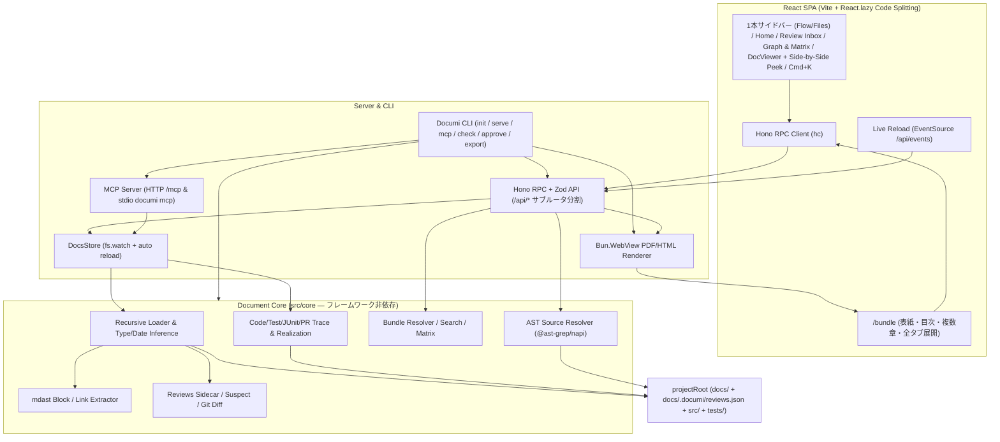

# システム全体構成

Documi は単一の TypeScript プロジェクトとして 3 層で構成し、Web UI・REST API・MCP Server・CLI がすべて同じ <Term name="DocsIndex" /> を共有する。

## パス解決と副作用の境界 (`projectRoot` / Functional Core)

- `<SourceRef file="src/..." />`・`<TermDef symbols="src/...#Symbol">`・`@implements` / `@verifies` の走査はすべて **`projectRoot` からの POSIX 相対パス** で解決する（`.mdx` ファイルからの相対パスではない）。
- `projectRoot` の既定値は `docs/` の親ディレクトリであり、モノレポ等で階層が異なる場合は `--project <dir>` または環境変数 `DOCUMI_PROJECT_ROOT` で全コマンド（`serve` / `mcp` / `check` / `export`）横断で上書きできる。
- 絶対パス・`..` によるパストラバーサル・`projectRoot` 外を指すシンボリックリンクは `src/core/source.ts` で拒否する。
- **純粋計算と副作用の境界**: `src/core/` はフレームワーク非依存を保ち、解析・グラフ構築・ハッシュ・Diff・Realization 集計・バンドル解決の計算ロジックを独立させる。HTTP・SSE・ファイル監視・PDF レンダリング等の入出力副作用は `src/server/` および `src/cli.ts` の境界層に閉じ込める。

## 5 層・9 種類の Artifact Type と AI コンテキスト方針

| 層 | Type | AI コンテキストでの扱い |
|---|---|---|
| **Boundary** | `goal`, `decision` | `goal` 全文と `decision` の `<Outcome>` を常時投入 |
| **Domain** | `domain` | 用語とコードシンボル対応を常時投入 |
| **Normative** | `spec`, `contract` | 実装・検証対象の機能について必須投入 |
| **Realization** | `architecture`, `design`, `verification` | `architecture` は常時、`design` / `verification` は対象機能のみ |
| **Informative** | `guide` | 手順確認など必要時のみ参照 |
