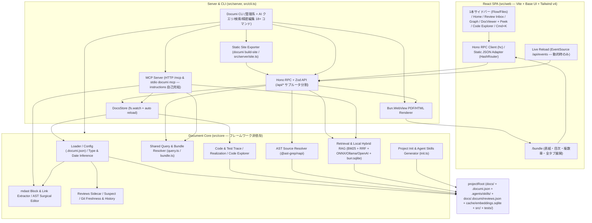

# システム全体構成

Documi は単一の TypeScript プロジェクトとして 3 層で構成し、Web UI・REST API・MCP Server・CLI・静的サイト書き出しのすべてが同じ <Term name="DocsIndex" /> とフレームワーク非依存の Document Core (`src/core`) を共有する。

## 1. パス解決・設定ファイル・副作用の境界 (`projectRoot` / Functional Core)

- **同一リポジトリ・同一ブランチ既定**: `docs/` とプロジェクトコードは同一リポジトリ・同一ブランチに共存させることを標準とし、1 つの PR 内で仕様・実装・テスト・`documi check` を原子的に検証する（[ADR](../decisions/2026-11-code-explorer-and-mcp-editing.mdx)）。
- **プロジェクト設定と双方向パス解決 (`src/core/config.ts`)**: `projectRoot` 直下の `.documi.json`（または `.documi.yml` / `.documi.yaml` / `documi.json`）から `docs`・`testReport`・任意の `rag` 設定を読み込む。CLI / サーバー / MCP の全経路で `--project` のみ指定時は `<projectRoot>/<docs>` を、`--docs` のみ指定時はその親ディレクトリを `projectRoot` として双方向に自動解決する。
- **ソース参照パスの基準**: `<SourceRef file="src/..." />`・`<TermDef symbols="src/...#Symbol">`・`@implements` / `@verifies` の走査および読み取り専用 Code Explorer はすべて **`projectRoot` からの POSIX 相対パス** で解決する。絶対パス・`..` によるパストラバーサル・`projectRoot` 外を指すシンボリックリンクは `src/core/source.ts` で拒否する。
- **純粋計算と副作用の境界**: `src/core/` は React・Hono・MCP SDK に一切依存せず、解析・グラフ構築・ハッシュ・Diff・Realization 集計・BM25/RRF 検索・グラフ文脈組立・クエリ投影・AST ブロック書き換え計算を独立させる。HTTP・SSE・ファイル監視・PDF レンダリング・静的サイト書き出しの副作用は `src/server/` および `src/cli.ts` に閉じ込める。

## 2. 永続化ファイルと派生キャッシュの分離

| パス | 役割 | Git 管理 | 書き込み主体 |
|---|---|---|---|
| `docs/**/*.mdx` / `.md` | Living Specification 本文（単一の真実の源） | コミット対象 | 人間・AI（ファイル直書き / CLI / MCP 精密編集） |
| `docs/.documi/reviews.json` | 人間承認記録・フィードバック専用サイドカー | コミット対象 | **人間専用**（AI 書き込み禁止、`--no-review-edit` で検証） |
| `.documi.json` | プロジェクト設定（`docs` / `testReport` / 任意 `rag`） | コミット対象 | 人間・`documi init` |
| `.agents/skills/*` | AI エージェント向け CLI 運用スキル (`--en` / `--ja`) | コミット対象 | `documi init`（既存 `AGENTS.md` には非干渉） |
| `docs/.documi/test-results.xml` | テスト実行結果（JUnit XML） | 任意（ローカル／CI） | テストランナー |
| `docs/.documi/cache/embeddings.sqlite` | <Term name="HybridRAG" /> 用の `contentHash` 差分ベクトルキャッシュ | `.gitignore` 対象 | `documi index` / `--semantic` 実行時に自動生成 |
| `docs/.documi/cache/approved-bodies.json` | 未コミット承認時の Diff 算出用本文キャッシュ | `.gitignore` 対象 | Web UI / `documi approve` |

## 3. 3 つの利用チャネル（人間 Web UI / AI CLI & MCP / 静的サイト）

- **人間向け動的 Web UI (`documi serve`)**: Hono RPC + React Query + SSE ライブ更新により、閲覧・承認・Git 鮮度/履歴比較・Code Explorer・Graph・PDF Export をリアルタイムに提供する。
- **AI 向け二本立て経路（MCP ＋ CLI & Agent Skills）**: `src/core/query.ts`・`src/core/retrieval.ts`・`src/core/hybrid-retrieval.ts`・`src/core/editor.ts` を共通基盤として、MCP サーバー（`instructions` 自己完結）と CLI（`documi retrieve` / `map` / `query` / `context` / `block` / `term` / `scaffold`、`--json`・`--full` 対応）が同等の機能を提供する（[ADR](../decisions/2026-11-24-ai-dual-channel-and-skills.mdx)）。
- **プロバイダ非依存の静的サイト書き出し (`documi build-site`)**: インメモリ Hono サーバーから全読み取り API JSON を事前計算し、ビルド済み SPA（`HashRouter` 切替）と合わせて任意の静的ホスティングへ配布できる読み取り専用サイトを出力する（[ADR](../decisions/2026-11-24-provider-agnostic-static-site.mdx)）。

## 4. 5 層・9 種類の Artifact Type と AI コンテキスト方針

| 層 | Type | AI コンテキストでの扱い |
|---|---|---|
| **Boundary** | `goal`, `decision` | `goal` 全文と `decision` の `<Outcome>` を常時投入 |
| **Domain** | `domain` | 用語とコードシンボル対応を常時投入 |
| **Normative** | `spec`, `contract` | 実装・検証対象の機能について必須投入 |
| **Realization** | `architecture`, `design`, `verification` | `architecture` は常時、`design` / `verification` は対象機能のみ |
| **Informative** | `guide` | 手順確認など必要時のみ参照 |
