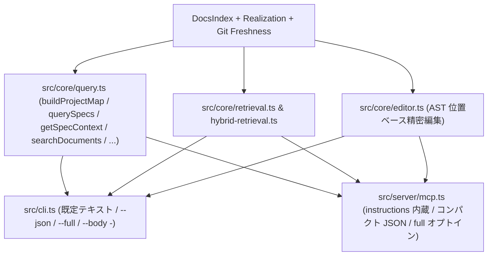

# AI CLI・MCP 共通クエリ層・設定解決・Agent Skills 初期化の設計

AI エージェントが MCP と CLI のどちらを経由しても同じ構造化文脈・精密編集・検証結果を得られるよう、共通クエリ層・設定解決・スキル初期化を `src/core/` に集約している（判断経緯は [AI 連携二本立て ADR](../decisions/2026-11-24-ai-dual-channel-and-skills.mdx)）。

## 1. 共通クエリ層 (`src/core/query.ts`) と 2 チャネル投影

- **既定コンパクト＋段階展開**: `buildProjectMap`・`querySpecs`・`getSpecContext` は既定で必要最小限のサマリ（ID・要約・状態・行番号）を返し、`full: true`（CLI では `--full`）指定時のみ全文や全トレース配列を展開する。
- **入力の安全性**: CLI の `block add` / `block update` / `scaffold` は `--body -`（標準入力ヒアドキュメント）および `--body-file` を受け付け、バッククォートや複数行 Markdown のシェルエスケープ崩れを防ぐ。

## 2. プロジェクト設定と双方向パス解決 (`src/core/config.ts`)

- `resolveProjectPaths()` は CLI 引数（`--project` / `--docs` / `--test-report`）・環境変数（`DOCUMI_PROJECT_ROOT` / `DOCUMI_DOCS_DIR`）・設定ファイル（`.documi.json` / `.documi.yml` / `.documi.yaml` / `documi.json`）を優先順位付きで解決する。
- `--project` のみ指定時は設定の `docs`（既定 `docs`）を結合し、`--docs` のみ指定時は親ディレクトリを `projectRoot` として逆算する。
- スキーマは Zod `.strict()` で検証し、未定義キーや不正な `rag` プロバイダ設定は即座に `ConfigError` として拒否する。

## 3. Agent Skills 配布と Brownfield 初期化 (`src/core/init.ts`)

- `initDocumiProject()` は `docs/` 初期雛形（未存在時のみ）と `<projectRoot>/.agents/skills/` 配下の 3 つのスキル（日常運用用 `documi/SKILL.md`・既存コードベース棚卸し用 `documi-bootstrap/SKILL.md`・対話型仕様レビュー＆認識合わせクイズ用 `documi-review/SKILL.md`）を、指定言語（`en` 既定 / `ja`）で冪等に生成する。
- 既存の `AGENTS.md` / `CLAUDE.md` は一切読み書きせず、既存のスキルファイルも `--force-skills` 指定時のみ上書きする。

## 4. コア実装参照

<SourceRef file="src/core/query.ts" symbol="buildProjectMap" satisfies="core.ai-cli" />

<SourceRef file="src/core/query.ts" symbol="getSpecContext" satisfies="core.ai-cli" />

<SourceRef file="src/core/config.ts" symbol="resolveProjectPaths" satisfies="core.project-config" />

<SourceRef file="src/core/init.ts" symbol="initDocumiProject" satisfies="core.agent-skills-init" />
