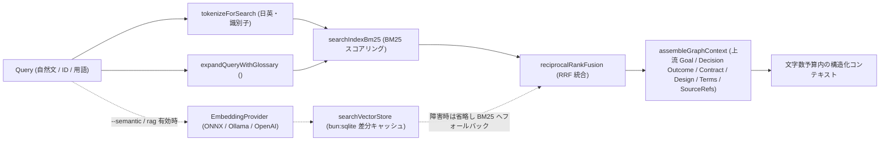

# Retrieval とローカル Hybrid RAG の設計

検索および文脈収集機能はフレームワーク非依存の 4 モジュール（`retrieval.ts` / `embeddings.ts` / `vector-store.ts` / `hybrid-retrieval.ts`）に分離し、CLI・MCP・REST API が同じ検索パイプラインを共有する（判断経緯は [ローカル Hybrid RAG ADR](../decisions/2026-11-24-local-hybrid-rag.mdx)）。

## 1. モジュール構成と検索パイプライン

## 2. 責務境界（純粋計算 vs 副作用）

| モジュール | 責務 | 副作用・外部依存 |
|---|---|---|
| `src/core/retrieval.ts` | 日英・識別子トークナイズ、`<TermDef aliases>` 同義語展開、BM25 スコアリング、RRF 順位統合、ヒット中心スニペット生成、明示グラフ展開と文字数予算制御 | なし（完全純粋・ゼロ外部依存） |
| `src/core/embeddings.ts` | `EmbeddingProvider` 抽象、モデル別プロンプト接頭辞（EmbeddingGemma / E5 / BGE / Nomic 等）、L2 正規化・内積計算、ONNX（`@huggingface/transformers` 遅延 `import`）・Ollama・OpenAI 互換 HTTP 実装 | モデル読込・HTTP 通信（呼び出し時のみ遅延発生） |
| `src/core/vector-store.ts` | `.documi/cache/embeddings.sqlite` のスキーマ管理、`contentHash` ベースの差分同期（追加・更新・削除）、正規化 `Float32Array` の内積検索 | `bun:sqlite` によるローカルキャッシュ I/O |
| `src/core/hybrid-retrieval.ts` | BM25 とベクトル検索の RRF 統合、自動差分同期、プロバイダ障害時の BM25 フォールバックと `mode` / `fallbackReason` 付与 | `embeddings.ts` / `vector-store.ts` の調停 |

## 3. チャンク設計と重複排除

- **検索対象は `docs/` のみ**: 文書単位とセマンティックブロック単位をチャンクとして扱い、同一文書内の子ブロックが上位ヒットした場合は冗長な親文書ヒットを重複排除する。
- **コードへはグラフ経由で到達**: ソースコード自体は埋め込まず、一次ヒットから `<SourceRef>` と `@implements` / `@verifies` を収集して返すことで、常に最新コードへ誘導する。
- **差分キャッシュの整合性**: 各チャンクの `contentHash` とモデル識別キー（`provider` + `model` + `dtype`）を主キーに管理し、本文未変更チャンクの再推論をスキップする。

## 4. コア実装参照

<SourceRef file="src/core/retrieval.ts" symbol="searchIndexBm25" satisfies="core.full-text-search" />

<SourceRef file="src/core/retrieval.ts" symbol="retrieveContext" satisfies="core.graph-retrieval" />

<SourceRef file="src/core/embeddings.ts" symbol="createEmbeddingProvider" satisfies="core.hybrid-rag" />

<SourceRef file="src/core/vector-store.ts" symbol="syncVectorIndex" satisfies="core.hybrid-rag" />

<SourceRef file="src/core/hybrid-retrieval.ts" symbol="retrieveContextHybrid" satisfies="core.hybrid-rag" />
