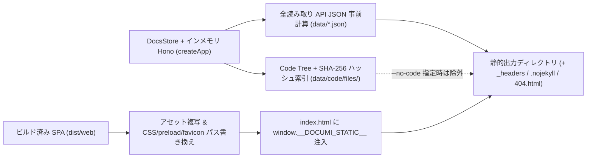

# プロバイダ非依存の静的サイト書き出しの設計

`documi build-site` は動的 Web UI と同一の React SPA・Hono API ロジックを再利用し、任意の静的ホスティングで動作する読み取り専用ディレクトリを生成する（判断経緯は [静的サイト書き出し ADR](../decisions/2026-11-24-provider-agnostic-static-site.mdx)）。

## 1. ビルドパイプライン (`src/server/site.ts`)

## 2. 主要な設計ポイント

- **インメモリ API スナップショット**: HTTP ポートを開かず `createApp().request(...)` で Overview・ツリー・全文書詳細・履歴・過去版・グラフ・マトリクス・検索インデックス・Material Icon マニフェスト＆使用アイコン SVG を事前計算し、`data/` 配下へ書き出す。
- **任意サブパス対応のアセット書き換え**:
  - CSS 内の `url(/assets/...)` フォント参照を相対 URL へ書き換え、Vite が生成する `preload-helper-*.js` の動的チャンク解決ベースパスと `favicon.svg` 参照も指定 `--base`（既定 `./`）へ整合させる。
  - 静的ホスティング向けの補助ファイル（`_headers`・`.nojekyll`・`404.html`）を自動出力する。
- **特殊ファイル名に対する安全なコード索引**: ソースコードファイルは元の相対パスを直接ディレクトリ構造にせず、`data/code/files/file-index.json`（相対パス → SHA-256 ハッシュ）と `data/code/files/<hash>.json` にマッピングすることで、ドットファイルや `[id].tsx` 等の CDN 制約を回避する。`--no-code` 指定時はコード全文と `<SourceRef>` 生抜粋を出力しない。
- **クライアント側の自動切替 (`src/web/api.ts` / `src/web/App.tsx`)**: `window.__DOCUMI_STATIC__` が存在するとき、フロントエンドは `BrowserRouter` ではなく `HashRouter` を選択し、API 呼び出しを `data/*.json` の静的 `fetch` に切り替え、SSE ライブ更新や承認書き込み UI を読み取り専用として無効化する。

## 3. 実装参照

<SourceRef file="src/server/site.ts" symbol="buildStaticSite" satisfies="core.static-site" />
