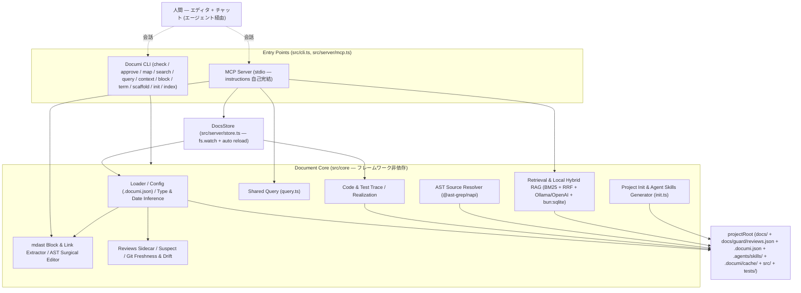

# システム全体構成

Documi は単一の TypeScript プロジェクトとして、フレームワーク非依存の Document Core (`src/core`) を中心に、AI エージェント向けの 2 経路（CLI と MCP stdio）だけを持つ。**人間向けの Web UI・REST API・静的サイト書き出し・PDF エクスポートは持たない**。人間はエディタで MDX を直接読み書きし、判断はチャット上のエージェントとの会話で行う（[chat-driven decisions](./chat-driven-decisions.mdx)）。

## 1. パス解決・設定ファイル・副作用の境界 (`projectRoot` / Functional Core)

- **同一リポジトリ・同一ブランチ既定**: `docs/` とプロジェクトコードは同一リポジトリ・同一ブランチに共存させることを標準とし、1 つの PR 内で仕様・実装・テスト・`documi check` を原子的に検証する（[ADR](../decisions/2026-11-code-explorer-and-mcp-editing.mdx)）。
- **プロジェクト設定と双方向パス解決 (`src/core/config.ts`)**: `projectRoot` 直下の `.documi.json`（または `.documi.yml` / `.documi.yaml` / `documi.json`）から `docs`・`testReport`・任意の `rag` 設定を読み込む。CLI / MCP の全経路で `--project` のみ指定時は `<projectRoot>/<docs>` を、`--docs` のみ指定時はその親ディレクトリを `projectRoot` として双方向に自動解決する。
- **ソース参照パスの基準**: `<SourceRef file="src/..." />`・`<TermDef symbols="src/...#Symbol">`・`@implements` / `@verifies` の走査はすべて **`projectRoot` からの POSIX 相対パス** で解決する。絶対パス・`..` によるパストラバーサル・`projectRoot` 外を指すシンボリックリンクは `src/core/source.ts` で拒否する。
- **純粋計算と副作用の境界**: `src/core/` は MCP SDK に一切依存せず、解析・グラフ構築・ハッシュ・Realization 集計・BM25/RRF 検索・グラフ文脈組立・クエリ投影・AST ブロック書き換え計算を独立させる。ファイル監視・stdio 通信・プロセス入出力の副作用は `src/server/` および `src/cli.ts` に閉じ込める。

## 2. 永続化ファイルと派生キャッシュの分離

| パス | 役割 | Git 管理 | 書き込み主体 |
|---|---|---|---|
| `docs/**/*.mdx` / `.md` | Living Specification 本文（単一の真実の源） | コミット対象 | 人間・AI（ファイル直書き / CLI / MCP 精密編集） |
| `docs/guard/reviews.json` | 人間承認記録・確認メモ専用ガードファイル | コミット対象 | **人間専用**（AI 書き込み禁止、`--no-review-edit` / `CODEOWNERS` で検証） |
| `.documi.json` | プロジェクト設定（`docs` / `testReport` / 任意 `rag`） | コミット対象 | 人間・`documi init` |
| `.agents/skills/*` | AI エージェント向け CLI 運用スキル 5 種（`documi` / `documi-design` / `documi-bootstrap` / `documi-review` / `documi-audit`） | コミット対象 | `documi init`（既存 `AGENTS.md` には非干渉） |
| `.documi/test-results.xml` | テスト実行結果（JUnit XML） | `.gitignore` 対象 | テストランナー |
| `.documi/cache/embeddings.sqlite` | <Term name="HybridRAG" /> 用の `contentHash` 差分ベクトルキャッシュ | `.gitignore` 対象 | `documi index` / `--semantic` 実行時に自動生成 |
| `.documi/cache/approved-bodies.json` | 未コミット承認時の Diff 算出用本文キャッシュ | `.gitignore` 対象 | `documi approve` |

## 3. 利用チャネル（AI エージェントファースト）

- **AI 向け二本立て経路（MCP ＋ CLI & Agent Skills）**: `src/core/query.ts`・`src/core/retrieval.ts`・`src/core/hybrid-retrieval.ts`・`src/core/editor.ts` を共通基盤として、MCP サーバー（stdio・`instructions` 自己完結）と CLI（`documi search --context` / `map` / `query` / `context` / `block` / `term` / `scaffold`、`--json`・`--full` 対応）が同等の機能を提供する（[ADR](../decisions/2026-11-24-ai-dual-channel-and-skills.mdx)）。
- **人間の経路**: 人間はドキュメントをエディタで直接読み書きし、質問・判断・監査はエージェントとのチャットで行う。人間が受け身で訪れる専用画面は用意しない。pull 型の注意モデルは成立しないことがカードシステムの失敗で実証されたため（[chat-driven decisions](./chat-driven-decisions.mdx)）。

## 4. 5 層・7 種類の Artifact Type と AI コンテキスト方針

| 層 | Type | AI コンテキストでの扱い |
|---|---|---|
| **Boundary** | `goal`, `decision` | `goal` 全文と独立 `decision` の `<Decision>` を常時投入 |
| **Domain** | `domain` | 用語とコードシンボル対応を常時投入 |
| **Normative** | `spec`, `contract` | 実装・検証対象の機能について必須投入（保証シナリオ `<Test>` を同居） |
| **Realization** | `design` | 全体設計（`scope: system`）は常時、機能別 `design` は対象機能のみ投入 |
| **Informative** | `guide` | 手順確認など必要時のみ参照 |

## 5. システム横断の不変制約（System Constraints）

<Constraint id="sys.no-arbitrary-js" scope="mdx" stability="stable">
  MDX 内の任意 JavaScript (ESM import/export、JSX 式、未許可コンポーネント) は一切実行しない。許可リストのセマンティックタグのみを AST ベースで安全に処理する。
</Constraint>

<Constraint id="sys.fs-sot" scope="architecture" stability="stable">
  ファイルシステム上の Markdown / MDX を Single Source of Truth とし、MCP Server・CLI はすべてフレームワーク非依存の Document Core (`src/core/`) を共有する。
</Constraint>

<Constraint id="sys.pre-release-policy" scope="workflow" stability="evolving">
  未リリース開発期間中は後方互換レイヤ（v1/v2 分岐・非推奨エイリアス・DB マイグレーション）を溜めず現行実装を直接書き換える。パッケージ公開・タグ打ち・リリースノート作成等のリリース準備は、人間の明示的な指示なしに開始しない。
</Constraint>
