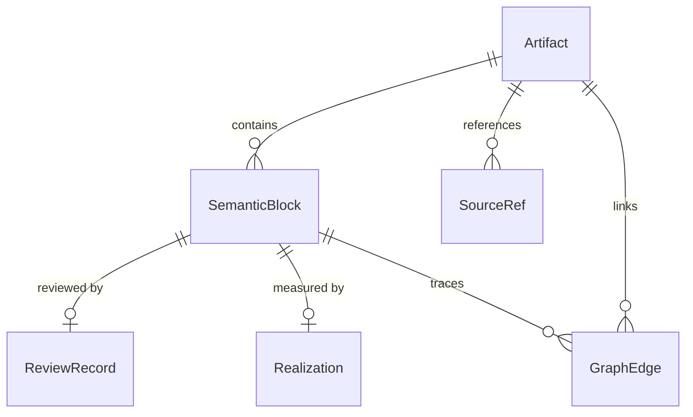
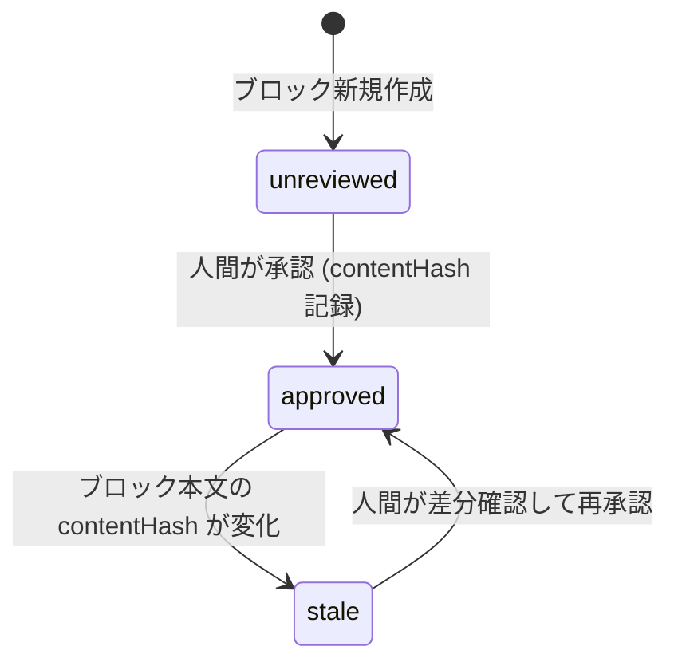

# ドメインモデル・状態遷移・不変条件

Documi の中核概念同士の関係、取り得る状態遷移、および UI や保存形式が変わっても揺るがないドメイン不変条件を定義する（各用語の定義とコードシンボル対応は [ドメイン用語集](./glossary.mdx) を参照）。

## 1. 概念モデルと関係



- **集約の考え方**:
  - <Term name="Artifact" /> は複数の <Term name="SemanticBlock" /> と <Term name="SourceRef" /> を包含する文書単位。
  - <Term name="ReviewRecord" /> は本文とは独立したサイドカー上に存在し、`SemanticBlock.id` を鍵として 1:0..1 で結びつく。
  - <Term name="Realization" /> は保存データではなく、ソース・テスト・JUnit・PR の観測結果から実行時に毎回導出される読み取り専用の値オブジェクト。

## 2. 状態遷移モデル（Lifecycles）

Documi は **人間承認 (`ReviewStatus` + `suspect`)** と **実装・検証状態 (`RealizationStatus`)** を完全に独立した 2 軸として扱う。

### 2.1 人間レビュー状態 (`ReviewStatus`)



- `approved` であっても、上流（`derives` 先）のブロックまたは文書のハッシュが承認時点から変化した場合は、直交フラグ **`suspect = true`** が自動付与される（再承認で解消）。

### 2.2 実現状態 (`RealizationStatus`)

```mermaid
stateDiagram-v2
    [*] --> unimplemented: コード・テスト・PR の紐づきなし
    unimplemented --> in-progress: オープン PR が紐づく
    unimplemented --> implemented: 実装アンカーのみ存在
    in-progress --> implemented: 実装アンカーが追加される
    implemented --> verified: 紐づくテストが存在し JUnit 全件成功
    in-progress --> verified: 実装かつテスト全件成功
    implemented --> drifted: 紐づくテスト失敗 または 参照破損
    verified --> drifted: 紐づくテスト失敗 または 参照破損
    drifted --> verified: 失敗テスト・破損参照を解消し全件成功
```

- **禁止遷移（構造上の制約）**: 人間がドキュメントを手動編集して `verified` へ直接遷移させることはできない（常に観測結果から算出する）。

## 3. ドメイン不変条件（Domain Invariants）

1. **ID の一意性**: すべての <Term name="Artifact" /> ID（拡張子なしの POSIX 相対パス）および <Term name="SemanticBlock" /> ID（`^[a-zA-Z][a-zA-Z0-9._-]*$`）はプロジェクト全体で一意でなければならない。
2. **Rooted DAG（脱線と循環の禁止）**: `intent="normative"` な `<Spec>` ブロックは、`derives` を辿って必ず 1 つ以上の `goal` に到達可能でなければならず、トレーサビリティ辺（`derives` / `satisfies` / `verifies` / `supersedes`）に循環を含んではならない。
3. **承認と本文の物理分離**: 人間の承認事実（<Term name="ReviewRecord" />）は仕様本文に混在させず、AI エージェントは承認記録を改変してはならない。
4. **実現状態の非手書き性**: <Term name="Realization" /> は手動で上書きできず、コード・テスト・JUnit・PR の実測のみから決定される。
5. **参照境界の安全性**: すべての <Term name="SourceRef" /> および `<TermDef symbols>` は <Term name="ProjectRoot" /> 内の POSIX 相対パスであり、ルート外への脱出を一切許さない。
