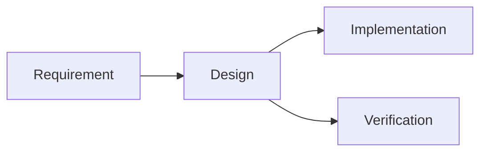

# MDX コンポーネントとリッチ表現

Documi は Markdown に加えて、許可された MDX コンポーネントとリッチ表現をサポートします。
任意の JavaScript は実行されません。

## Callout

<Callout type="info" title="情報">
Callout は補足情報を目立たせるためのコンポーネントです。
type には `note` / `info` / `tip` / `warning` / `danger` / `success` が使えます。
</Callout>

## Tabs

<Tabs>
<Tabs.Tab label="Markdown">
通常の Markdown 記法がそのまま使えます。

- リスト
- **強調**
</Tabs.Tab>
<Tabs.Tab label="MDX">
許可されたコンポーネントだけが描画されます。
</Tabs.Tab>
</Tabs>

## Steps

<Steps>
<Steps.Step title="文書を作成する">
`NNNNN-kebab-case-slug.mdx` で保存します（`.md` も読み込み可能です）。
</Steps.Step>
<Steps.Step title="Frontmatter を書く">
type / title / description / status は必須です。
</Steps.Step>
<Steps.Step title="Relations を定義する">
参照先の Type と ID を frontmatter に記述します。
</Steps.Step>
</Steps>

## Mermaid



## 数式 (KaTeX)

インライン数式: $f(x) = x^2 + 1$

ブロック数式:

$$
\min_{x \in X} f(x)
$$

## シンタックスハイライト (Shiki)

```ts
export function documentRef(type: string, id: string): string {
  return `${type}:${id}`
}
```

## SourceRef — ソースコード参照

文書から実際のソースファイルの定義を参照できます。

### シンボル参照 (AST 解決)

<SourceRef file="src/core/source.ts" symbol="resolveSourceSymbol" />

### 行範囲参照

<SourceRef file="src/core/loader.ts" lines="35-45" />

対応言語: TypeScript / TSX / JavaScript / Go / Rust / Python / Java / Kotlin / Swift。
シンボルは `Registry.register` のような修飾名で指定できます。
