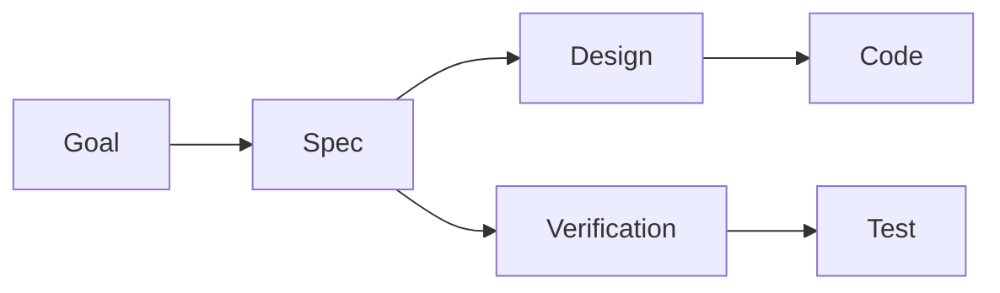

# Getting Started & 運用ガイド

## セットアップと起動

```bash
bun install
bun run dev      # Vite (5173) + Hono (3000, docs 自動監視・SSE ホットリロード)
bun run build    # フロントエンドを dist/ にビルド
bun run start    # 本番サーバー起動 (http://localhost:3000)
```

他プロジェクトへ導入する場合は CLI からそのまま初期化・起動できます。AI エージェント連携は **「CLI + Agent Skills（MCP 設定不要）」** と **「MCP サーバー単体（`instructions` 内蔵で Skill 不要）」** の両方を完全にサポートしています。

```bash
documi init --project /path/to/repo           # <project>/docs 雛形 + .agents/skills/ 生成 (既定: --en / 日本語は --ja)
documi serve --project /path/to/repo          # Web UI + API + HTTP MCP 起動
documi mcp --project /path/to/repo            # stdio MCP サーバー起動 (MCP 派向け・Skill 不要)
```

`documi init` は `AGENTS.md` 等と競合させないよう、標準 **Agent Skills** 形式（`.agents/skills/`）で CLI ベースの以下 2 つのスキルを自動配置します：

- **`documi/SKILL.md`**: 日常開発で `documi map` → `documi query` / `search` → `documi context` → 精密編集（`documi block` / `term` / `scaffold`）→ `documi check` を使う運用スキル
- **`documi-bootstrap/SKILL.md`**: 既存コードベース（Brownfield）を棚卸しし、初期 Goal・Architecture・用語集・コア仕様を段階的に立ち上げるスキル

言語は `--en`（既定）または `--ja`（`--lang ja`）で切り替えられます。既存の `docs/` があるプロジェクトやスキルだけ更新したい場合は `--skills-only` / `--force-skills` を利用できます。また既存の `docs/` と分けたい場合はプロジェクトルート直下に `.documi.json`（または `.documi.yml`）を置くことで `--project` 1 つで自動認識されます。

```json
{
  "docs": "documi",
  "testReport": "documi/.documi/test-results.xml"
}
```

> ソースコード参照（`<SourceRef file="src/..." />` / `<TermDef symbols="src/...#Sym">`）はすべて <Term name="ProjectRoot" />（既定: `cwd`、または `--docs` 指定時はその親ディレクトリ、`--project` / `DOCUMI_PROJECT_ROOT` で明示指定可）からの POSIX 相対パスで記述します。

## Web UI の読み方・レビューの進め方

- **1 本サイドバー (`Flow` / `Files`)**: 既定の `Flow` モードでは `Goals → Architecture → Domain → Specs → Contracts → Designs → Decisions → Verification → Guides` の読み順で並びます。フォルダ構造で見たいときは `Files` へ切り替えます。
- **Review Queue (`/review`)**: AI が新規作成・変更したブロックを `要確認 (Stale/Suspect)`・`未解決フィードバック`・`未承認` で絞り込み、行 Diff 確認やワンクリック承認、元文書の「並べて確認」が行えます。
- **並べて読む（Side-by-Side プレビュー）**:
  - ドキュメント閲覧中、右パネルの `Links` タブにある分割ボタン（またはリンクを **`Shift+クリック`**）で関連文書を右側に並べて比較できます。
  - `/graph` でノードをクリックすると、グラフを離れずに右側にその文書・ブロック本文が即時表示されます。
- **キーボードショートカット**:
  - `Cmd+K` / `Ctrl+K`: ドキュメント・Spec ID・用語・本文の全文検索モーダルを開く
  - `Cmd+B` / `Ctrl+B`: 左サイドバーを開閉して読書・グラフ領域を広げる

## ADR (`decision`) の書き方

- frontmatter に任意で ISO 8601 の **`date: YYYY-MM-DD`**（または `YYYY-MM`、MADR 4.0 準拠）を付けると、一覧や Overview で新しい決定日順に並びます。
- ファイル名の日付プレフィックス（例: `decisions/2026-11-hono-rpc-and-zod-api.mdx`）は強制ではありませんが、並列作成時の衝突回避と履歴の可読性のため推奨します。
- 決定の結論は 2〜3 行で `<Outcome id="dec.xxx">` に囲むと、AI への常時コンテキストとして優先投入されます。

## テスト結果の反映・CI・`CODEOWNERS`

テスト名に `[spec.id]` を含めて JUnit レポートを出力すると、Web UI と CLI の両方で `Verified` 状態が自動反映されます。

```bash
# テストを実行して JUnit レポートを出力
bun test --reporter=junit --reporter-outfile=docs/.documi/test-results.xml

# 構造・Rooted DAG・AST シンボル・テスト結果を一括チェック
bun run documi:check

# AI 作業ブランチで reviews.json の改変を禁止する CI チェック
bun src/cli.ts check --no-review-edit

# CLI からブロックを承認
bun src/cli.ts approve core.document-model
```

- `.github/workflows/ci.yml` で PR ごとにテスト・型・lint・ビルド・`documi:check` を自動検証します。
- `.github/CODEOWNERS` で `docs/.documi/reviews.json` の変更にメンテナレビューを紐づけられます。

## 複数ドキュメントまとめ Export (HTML / PDF)

Web UI 上部の Export ボタン（または CLI）から、全ドキュメント・特定ディレクトリ・Goal 関連一式・任意複数選択を 1 冊の仕様書として出力できます。

```bash
bun run build
bun run documi:export -- --scope goal:goals/living-specification --format pdf --out spec.pdf
bun run documi:export -- --scope all --format html --out spec.html
```

## リッチ表現コンポーネント

<Callout type="tip" title="セマンティックタグとの使い分け">
  仕様・制約・結論・用語には `<Spec>` / `<Constraint>` / `<Outcome>` / `<TermDef>` を使い、説明の分かりやすさを高める補助表現として `<Callout>` / `<Tabs>` / `<Steps>` / Mermaid / KaTeX を組み合わせます。
</Callout>

<Tabs>
<Tabs.Tab label="Mermaid 図">

</Tabs.Tab>
<Tabs.Tab label="数式 (KaTeX)">
インライン数式 $f(x) = x^2 + 1$ およびブロック数式：

$$
\text{TraceCoverage} = \frac{|\text{Verified Specs}|}{|\text{Normative Specs}|}
$$
</Tabs.Tab>
</Tabs>

詳しくは [ドキュメント執筆ガイド](./authoring-guide.mdx)、[ドキュメントモデル仕様](../specs/core/document-model.mdx)、[CLI コントラクト](../contracts/cli.mdx)、[ドメイン用語集](../domain/glossary.mdx) を参照してください。
