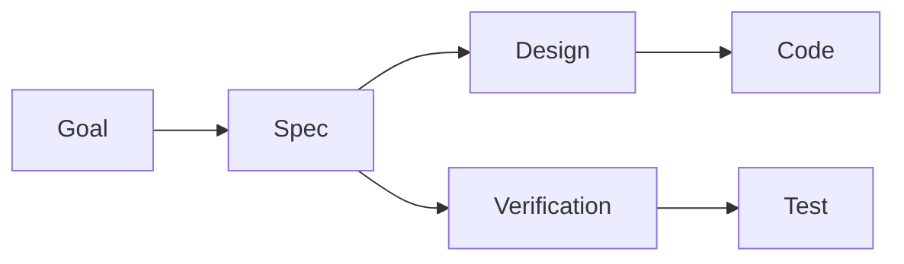

# Getting Started & 運用ガイド

## セットアップと起動

```bash
bun install
bun run dev      # Vite (5173) + Hono (3000, docs 自動監視・SSE ホットリロード)
bun run build    # フロントエンドを dist/ にビルド
bun run start    # 本番サーバー起動 (http://localhost:3000)
```

## テスト結果の反映と整合性チェック (CLI)

テスト名に `[spec.id]` を含めて JUnit レポートを出力すると、Web UI と CLI の両方で `Verified` 状態が自動反映されます。

```bash
# テストを実行して JUnit レポートを出力
bun test --reporter=junit --reporter-outfile=docs/.documi/test-results.xml

# 構造・Rooted DAG・AST シンボル・テスト結果を一括チェック
bun run documi:check

# AI 作業ブランチで reviews.json の改変を禁止する CI チェック
bun src/cli.ts check --no-review-edit

# CLI からブロックを承認
bun src/cli.ts approve core.document-model
```

## 複数ドキュメントまとめ Export (HTML / PDF)

Web UI 右上の Export ボタン（または CLI）から、全ドキュメント・特定ディレクトリ・Goal 関連一式・任意複数選択を 1 冊の仕様書として出力できます。

```bash
bun run build
bun run documi:export -- --scope goal:goals/living-specification --format pdf --out spec.pdf
bun run documi:export -- --scope all --format html --out spec.html
```

## キーボードショートカット

- `Cmd+K` / `Ctrl+K`: ドキュメント・Spec ID・用語・本文の全文検索モーダルを開く

## リッチ表現コンポーネント

<Callout type="tip" title="セマンティックタグとの使い分け">
  仕様・制約・結論・用語には `<Spec>` / `<Constraint>` / `<Outcome>` / `<TermDef>` を使い、説明の分かりやすさを高める補助表現として `<Callout>` / `<Tabs>` / `<Steps>` / Mermaid / KaTeX を組み合わせます。
</Callout>

<Tabs>
<Tabs.Tab label="Mermaid 図">

</Tabs.Tab>
<Tabs.Tab label="数式 (KaTeX)">
インライン数式 $f(x) = x^2 + 1$ およびブロック数式：

$$
\text{TraceCoverage} = \frac{|\text{Verified Specs}|}{|\text{Normative Specs}|}
$$
</Tabs.Tab>
</Tabs>

詳しくは [ドキュメントモデル仕様](../specs/core/document-model.mdx)、[CLI コントラクト](../contracts/cli.mdx)、[ドメイン用語集](../domain/glossary.mdx) を参照してください。
