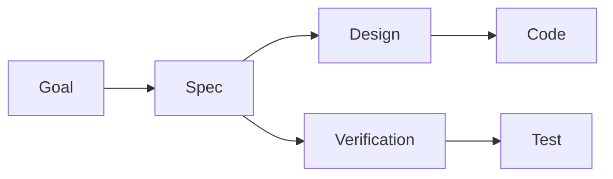

# Getting Started & 運用ガイド

## セットアップと起動

```bash
bun install
bun run dev      # Vite (5173) + Hono (3000, docs 自動監視・SSE ホットリロード)
bun run build    # フロントエンドを dist/ にビルド
bun run start    # 本番サーバー起動 (http://localhost:3000)
```

他プロジェクトへ導入する場合は CLI からそのまま初期化・起動できます。AI エージェント連携は **「CLI + Agent Skills（MCP 設定不要）」** と **「MCP サーバー単体（`instructions` 内蔵で Skill 不要）」** の両方を完全にサポートしています。

```bash
documi init --project /path/to/repo           # <project>/docs 雛形 + .agents/skills/ 生成 (既定: --en / 日本語は --ja)
documi serve --project /path/to/repo          # Web UI + API + HTTP MCP 起動
documi mcp --project /path/to/repo            # stdio MCP サーバー起動 (MCP 派向け・Skill 不要)
```

`documi init` は `AGENTS.md` 等と競合させないよう、標準 **Agent Skills** 形式（`.agents/skills/`）で CLI ベースの以下 4 つのスキルを自動配置します：

- **`documi/SKILL.md`**: 日常開発で `documi map` → `documi query` / `search` / `retrieve` → `documi context` → 精密編集（`documi block` / `term` / `scaffold`）→ `documi check` を使う運用スキル（再現性 4 チェック込み）
- **`documi-bootstrap/SKILL.md`**: 既存コードベース（Brownfield）を棚卸しし、初期 Goal・Architecture・用語集・コア仕様を段階的に立ち上げるスキル
- **`documi-review/SKILL.md`**: 未承認・`stale`・`suspect` な仕様を 2〜3 件ずつ取り上げ、エッジケースの選択式クイズで人間と AI の認識ズレを炙り出し、合意後に人間専用の最終確認 URL・承認コマンドを引き継ぐ対話レビュースキル
- **`documi-audit/SKILL.md`**: 実コード・テストと `docs/` を突き合わせ、「別 AI でも同じ挙動を再現できる解像度」に不足している境界条件・優先順位・スキーマ・外部契約・ADR 漏れを監査して肉付けするスキル

言語は `--en`（既定）または `--ja`（`--lang ja`）で切り替えられます。既存の `docs/` があるプロジェクトやスキルだけ更新したい場合は `--skills-only` / `--force-skills` を利用できます。また既存の `docs/` と分けたい場合はプロジェクトルート直下に `.documi.json`（または `.documi.yml`）を置くことで `--project` 1 つで自動認識されます。

```json
{
  "docs": "documi",
  "testReport": ".documi/test-results.xml"
}
```

> ソースコード参照（`<SourceRef file="src/..." />` / `<TermDef symbols="src/...#Sym">`）はすべて <Term name="ProjectRoot" />（既定: `cwd`、または `--docs` 指定時はその親ディレクトリ、`--project` / `DOCUMI_PROJECT_ROOT` で明示指定可）からの POSIX 相対パスで記述します。

## 人間と AI の標準フロー（Web UI ↔ AI チャット）

Documi は **AI が CLI / MCP で仕様・設計・コード・テストを書き、人間が Web UI（閲覧・Diff 確認・最終承認）と AI チャット（修正依頼・認識合わせクイズ）で判断する** 役割分担を前提にしています。

1. **AI に依頼する（AI チャット）**: 機能追加や仕様変更を伝えると、AI が `docs/`・コード・テストを同期更新し、`documi check --no-review-edit` まで通します。
2. **変更分を確認する（Web UI `/review`）**: `documi serve` で開いたブラウザは SSE で自動更新され、**`変更あり` タブ**（現在の作業ツリー・ブランチ差分で変更されたブロックのみ）や **`要再確認` タブ**（`stale` の自動展開 Diff・上流変更の軽量な `suspect` 参考通知）から差分をすぐ確認できます。
3. **ズレを直す・理解を深める（Web UI → AI チャット）**:
   - 直したい・質問したいブロックは **「AI へ伝える」** ボタンで参照を 1 クリックコピーして AI チャットへ渡します。
   - 重要な仕様や未承認ブロックはカードを選択して **「AI クイズでレビュー」** をコピーし、`documi-review` スキルで 2〜3 件ずつエッジケースを確認できます。
4. **最終確認 URL から承認する（人間専用）**: `documi-review` で認識が揃ったら、AI が発行する最終確認 URL（`/review?ids=id1,id2&note=...`）を開き、確認メモを添えて **「この N 件をまとめて承認」** を 1 クリックします（ターミナルから `documi approve <id...> --note "..."` や `documi unapprove <id...>` も可能）。AI が `docs/guard/reviews.json` を触ることは CI の `documi check --no-review-edit` と `.github/CODEOWNERS` で防ぎます。

## Web UI の読み方・レビューの進め方

- **1 本サイドバー (`Flow` / `Files`)**: 既定の `Flow` モードでは `Goals → Architecture → Domain → Specs → Contracts → Designs → Decisions → Verification → Guides` の読み順で並びます。フォルダ構造で見たいときは `Files` へ切り替えます。
- **Review Queue (`/review`)**: AI が新規作成・変更したブロックを `変更あり`・`要再確認 (Stale/Suspect)`・`未承認`・`承認済み` やブロック種別、最終確認 URL（`/review?ids=...&note=...`）で絞り込み、Markdown 本文・自動展開 Diff の確認、まとめて承認／個別承認／承認取消、AI 向け参照・クイズ依頼コピーが行えます。
- **並べて読む（Side-by-Side プレビュー）**:
  - ドキュメント閲覧中、右パネルの `Links` タブにある分割ボタン（またはリンクを **`Shift+クリック`**）で関連文書を右側に並べて比較できます。
  - `/graph` でノードをクリックすると、グラフを離れずに右側にその文書・ブロック本文が即時表示されます。
- **キーボードショートカット**:
  - `Cmd+K` / `Ctrl+K`: ドキュメント・Spec ID・用語・本文の全文検索モーダルを開く
  - `Cmd+B` / `Ctrl+B`: 左サイドバーを開閉して読書・グラフ領域を広げる

## ADR (`decision`) の書き方

- frontmatter に任意で ISO 8601 の **`date: YYYY-MM-DD`**（または `YYYY-MM`、MADR 4.0 準拠）を付けると、一覧や Overview で新しい決定日順に並びます。
- ファイル名の日付プレフィックス（例: `decisions/2026-11-hono-rpc-and-zod-api.mdx`）は強制ではありませんが、並列作成時の衝突回避と履歴の可読性のため推奨します。
- 決定の結論は 2〜3 行で `<Outcome id="dec.xxx">` に囲むと、AI への常時コンテキストとして優先投入されます。

## テスト結果の反映・CI・`CODEOWNERS`

テスト名に `[spec.id]` を含めて JUnit レポートを出力すると、Web UI と CLI の両方で `Verified` 状態が自動反映されます。

```bash
# テストを実行して JUnit レポートを出力
bun test --reporter=junit --reporter-outfile=.documi/test-results.xml

# 構造・Rooted DAG・AST シンボル・テスト結果を一括チェック
bun run documi:check

# AI 作業ブランチで docs/guard/reviews.json の改変を禁止する CI チェック
bun src/cli.ts check --no-review-edit

# CLI からブロックを承認・承認取り消し（人間専用）
bun src/cli.ts approve core.document-model --note "挙動を確認"
bun src/cli.ts unapprove core.document-model
```

- `.github/workflows/ci.yml` で PR ごとにテスト・型・lint・ビルド・`documi:check` を自動検証します。
- `.github/CODEOWNERS` で `docs/guard/**`・`docs/decisions/**` の変更にメンテナレビューを紐づけられます。

## 複数ドキュメントまとめ Export (HTML / PDF)

Web UI 上部の Export ボタン（または CLI）から、全ドキュメント・特定ディレクトリ・Goal 関連一式・任意複数選択を 1 冊の仕様書として出力できます。

```bash
bun run build
bun run documi:export -- --scope goal:goals/living-specification --format pdf --out spec.pdf
bun run documi:export -- --scope all --format html --out spec.html
```

## 検索・ローカル Hybrid RAG（BM25 + Embedding + グラフ展開）

既定で **日本語・英語・コード識別子対応 BM25 ＋ `<TermDef aliases>` 同義語展開 ＋ 明示グラフ展開** がゼロ依存で動作します。Spec ID が分からない自然文の質問から、関連 Spec・上流 Goal・Decision `<Outcome>`・`<SourceRef>` を 1 発で取得できます。

```bash
documi retrieve "承認記録の改ざん防止ルール"           # ゼロ依存 BM25 + グラフ展開（既定）
documi index                                         # ローカル ONNX (EmbeddingGemma 300M q4) で差分インデックス構築
documi retrieve "アカウント凍結時の挙動" --semantic  # BM25 + ローカル Embedding の RRF ハイブリッド検索
```

プロジェクト全体で Hybrid RAG を既定有効化したり、Ollama / OpenAI 互換エンドポイントへ切り替える場合は `.documi.json` に `rag` を追加します（ベクトルキャッシュは `.documi/cache/embeddings.sqlite` に `contentHash` 差分で保存されます）：

```json
{
  "docs": "docs",
  "rag": {
    "enabled": true,
    "provider": "onnx",
    "model": "onnx-community/embeddinggemma-300m-ONNX",
    "dtype": "q4"
  }
}
```

- Ollama を使う場合: `"provider": "ollama", "model": "embeddinggemma", "endpoint": "http://localhost:11434"`
- OpenAI 互換 API / LM Studio を使う場合: `"provider": "openai", "model": "text-embedding-3-small", "endpoint": "https://api.openai.com/v1", "apiKeyEnv": "OPENAI_API_KEY"`

## 静的サイト書き出し（オプション）

ローカル環境を持たないチームメンバーや非エンジニアとも読み取り専用で Web UI を共有したい場合、オプションとしてプロバイダ非依存の静的サイト（`dist-site/`）を生成できます。`HashRouter` と相対ベースパス（既定 `./`）を使うため、サーバー側のリライトルールなしで任意の静的ホスティングに配置できます。

```bash
bun run build
bun run documi:build-site -- --out dist-site           # コード閲覧込みで静的サイト生成
bun run documi:build-site -- --out dist-site --no-code # ソースコードを除外して仕様書のみ公開
```

生成された `dist-site/` はどの静的配信サービスにもそのままデプロイできます（サブパス配信する場合は `--base /docs/` を指定）：

- **Cloudflare Pages**: `npx wrangler pages deploy dist-site --project-name <name>`（`_headers` により `/assets/*` は immutable キャッシュ、`/data/*` は毎回再検証）
- **Cloudflare Workers Static Assets**: `wrangler.jsonc` に `"assets": { "directory": "./dist-site" }` を設定して `npx wrangler deploy`
- **Vercel**: ビルド出力ディレクトリに `dist-site` を指定（または `npx vercel deploy dist-site --prod`）
- **Netlify**: Publish directory に `dist-site` を指定（または `npx netlify deploy --dir=dist-site --prod`、`_headers` 自動認識）
- **GitHub Pages / AWS S3 / GCS / Nginx**: `dist-site/` の中身をそのままアップロード（`.nojekyll`・`404.html` 同梱済み）

## リッチ表現コンポーネント

<Callout type="tip" title="セマンティックタグとの使い分け">
  仕様・制約・結論・用語には `<Spec>` / `<Constraint>` / `<Outcome>` / `<TermDef>` を使い、説明の分かりやすさを高める補助表現として `<Callout>` / `<Tabs>` / `<Steps>` / Mermaid / KaTeX を組み合わせます。
</Callout>

<Tabs>
<Tabs.Tab label="Mermaid 図">

</Tabs.Tab>
<Tabs.Tab label="数式 (KaTeX)">
インライン数式 $f(x) = x^2 + 1$ およびブロック数式：

$$
\text{TraceCoverage} = \frac{|\text{Verified Specs}|}{|\text{Normative Specs}|}
$$
</Tabs.Tab>
</Tabs>

詳しくは [ドキュメント執筆ガイド](./authoring-guide.mdx)、[ドキュメントモデル仕様](../specs/core/document-model.mdx)、[CLI コントラクト](../contracts/cli.mdx)、[ドメイン用語集](../domain/glossary.mdx) を参照してください。
